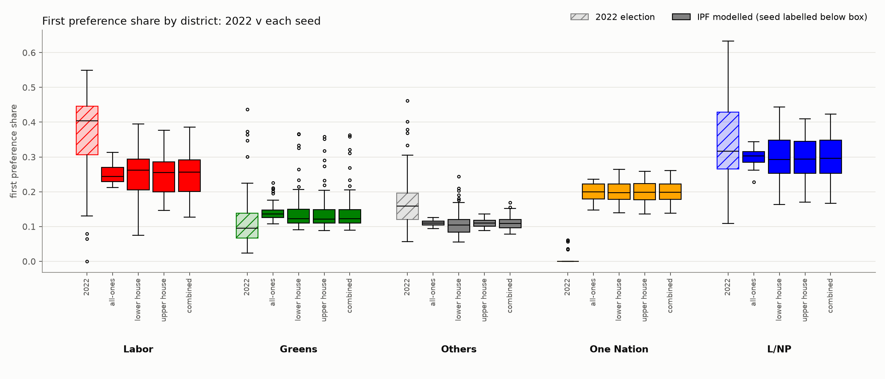
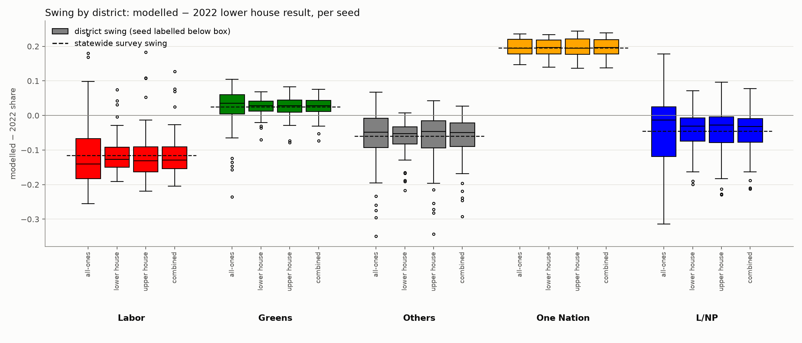
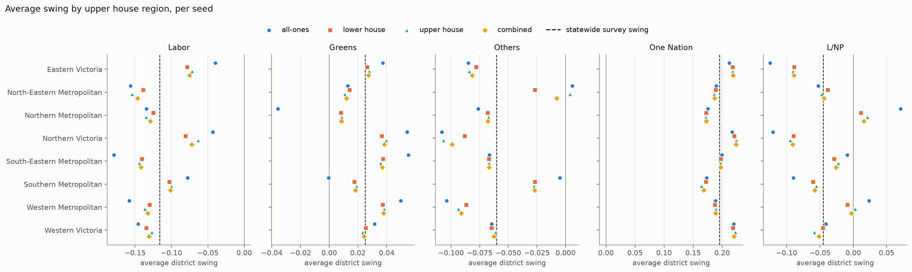
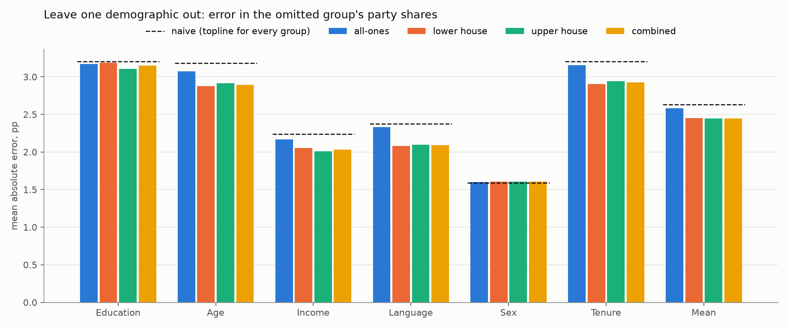

# Seed matrix comparison

**Recommendation: use the `2022-combined` seed (upper house weight 0.5).** For Labor, the Coalition and the Greens it is almost as good as the lower house seed. It removes most of the lower house seed's One Nation distortion, and it keeps the independent and minor-party pattern that the upper house seed loses.

Generated by [`seed_comparison.py`](seed_comparison.py). Sep 2026 survey, adult-citizen population base, `--seed-weight 1`, default smoothing (alpha = mean district formal vote, about a 50/50 mix with statewide shares). The swing (`--apply-swing`) is applied to all three 2022 seeds.

| Seed | Settings |
|---|---|
| all-ones | `--seed-matrix all-ones`: demographics only, no district pattern |
| lower house | `--seed-matrix 2022-results --apply-swing` |
| upper house | `--seed-matrix 2022-upper-house --apply-swing` |
| combined | `--seed-matrix 2022-combined --upper-house-weight 0.5 --apply-swing` |

## 1. Spread across districts compared with 2022

Standard deviation across districts (pp), with rank correlation against the 2022 lower house result in brackets:

| Seed | Labor | Greens | Others | One Nation | L/NP |
|---|---|---|---|---|---|
| 2022 actual | 11.1 | 7.6 | 7.9 | 1.2 | 11.3 |
| all-ones | 2.6 (0.55) | 2.2 (0.54) | 0.8 (−0.30) | 2.3 | 2.2 (0.73) |
| lower house | **6.7 (0.95)** | **5.6 (0.92)** | **3.6 (0.95)** | 2.6 | **6.4 (0.98)** |
| upper house | 5.4 (0.89) | 5.3 (0.86) | 1.1 (0.44) | 2.8 | 5.8 (0.95) |
| combined | 6.0 (0.92) | 5.4 (0.90) | 1.8 (0.87) | 2.7 | 6.1 (0.97) |

- **all-ones** is far too flat. Demographics alone produce about a quarter of 2022's spread for the major parties, and a negative rank correlation for Others.
- **The lower house seed** is closest to 2022 for every established party.
- **The upper house seed** flattens Others (SD 1.1, rank correlation 0.44). Upper house "Others" is a broad minor-party vote that misses lower house independents such as those in Mildura and Shepparton.
- **All seeds have only about half of 2022's spread.** That is mainly the default smoothing, which halves each district's own signal before the swing is applied. Lowering `--alpha` is the setting that would bring the spread back up.
- **Comparing against 2022 partly flatters the seeded runs**, because they are built from 2022 results. Treat this section as a sense check, not proof.

## 2. Swing by district

District swing = modelled share − 2022 lower house share. The dashed line is the survey's statewide swing.

SD of district swings (pp):

| Seed | Labor | Greens | Others | One Nation | L/NP |
|---|---|---|---|---|---|
| all-ones | 10.0 | 5.9 | 8.1 | 2.3 | 10.0 |
| lower house | **5.1** | **2.5** | **4.5** | **2.3** | **5.2** |
| upper house | 7.2 | 2.9 | 7.5 | 2.7 | 6.3 |
| combined | 6.1 | 2.7 | 6.3 | 2.5 | 5.7 |

- **all-ones produces implausible swings.** Its estimates are nearly flat, so its "swing" is mostly 2022's pattern reversed: L/NP +18 in Northcote, Labor −26 in Carrum, Greens −24 in Brunswick.
- **The seeded runs give swings of a plausible size.** The lower house seed is tightest, as expected from a seed built on the result it's compared against.
- **Labor's Narracan outliers are an artifact of the comparison.** Labor didn't stand in the 2023 Narracan supplementary election, so any Labor estimate there shows as a positive swing.
- **Upper house Others swings are extreme**, down to −34 in Mildura. The upper house seed has no record of the 2022 independent vote, so it predicts that vote disappears.

Averaged by upper house region, the three 2022 seeds agree closely with one another. all-ones is the outlier, for example L/NP +7 and Greens −4 in Northern Metropolitan, while the seeded runs give L/NP about +1 to +2 and Greens about +1 there.

## 3. Leave one demographic out

Each run was refitted six times. Each time, one demographic's survey demographic × party table was removed, while its census counts for each district were kept. I then compared the model's implied vote for that group with the survey's.

The seed is the same for every demographic group within a district, so the only way the model can recover how a group votes is from where that group lives. Points on the dashed line mean the model recovered the survey value without being given it. The "naive" baseline gives every group the statewide topline.

Mean absolute error (pp):

| Omitted | all-ones | lower house | upper house | combined | naive |
|---|---|---|---|---|---|
| Education | 3.17 | 3.19 | 3.11 | 3.15 | 3.21 |
| Age | 3.07 | 2.88 | 2.91 | 2.89 | 3.18 |
| Income | 2.17 | 2.05 | 2.01 | 2.03 | 2.24 |
| Language | 2.33 | 2.08 | 2.10 | 2.09 | 2.38 |
| Sex | 1.60 | 1.61 | 1.61 | 1.61 | 1.59 |
| Tenure | 3.16 | 2.91 | 2.94 | 2.92 | 3.21 |
| **Mean** | **2.58** | **2.45** | **2.45** | **2.45** | **2.63** |

Plots for each seed: [all-ones](seed_comparison_lodo_all-ones.png) · [lower house](seed_comparison_lodo_lower_house.png) · [upper house](seed_comparison_lodo_upper_house.png) · [combined](seed_comparison_lodo_combined.png)

- **This test doesn't separate the three 2022 seeds**: they tie at 2.45. Each beats all-ones (2.58), most clearly for age, tenure and language, where 2022 geography lines up with where those groups live.
- **No seed does much better than naive** (2.63). In the plots, the predicted points are compressed toward the topline. For example, the model gives renters about 29% L/NP against the survey's 19%.
- **The test is a structural check, not a way to choose a seed.** Almost all of the model's knowledge of how a demographic votes comes from the survey table, not from geography. If a survey table is noisy or missing, the seed can't make up for it.

## 4. One Nation: the deciding factor

One Nation stood in only 5 lower house seats in 2022. The swing lifts its seed to about 20% everywhere, and those 5 seats keep a few points extra:

Rank of those 5 seats out of 88:

| District | all-ones | lower house | upper house | combined | 2022 upper house vote (actual) |
|---|---|---|---|---|---|
| Morwell | 4 | 1 | 1 | 1 | 1 |
| Narracan | 9 | 2 | 2 | 2 | 2 |
| Bendigo East | 22 | 3 | 15 | 3 | 6 |
| Macedon | 26 | 4 | 22 | 15 | 20 |
| Pakenham | 30 | 5 | 19 | 13 | 11 |

Top 10 One Nation districts for each seed, with modelled first-preference share (%). The last column is One Nation's actual 2022 upper house vote, as a reference for where its support was. Seats marked * are the 5 it contested in the 2022 lower house.

| Rank | all-ones | lower house | upper house | combined | 2022 upper house vote (actual) |
|---|---|---|---|---|---|
| 1 | Hastings 23.6 | Morwell* 26.5 | Morwell* 25.8 | Morwell* 26.1 | Morwell* 6.6 |
| 2 | Gippsland East 23.4 | Narracan* 26.3 | Narracan* 25.0 | Narracan* 26.0 | Narracan* 6.1 |
| 3 | Euroa 23.3 | Bendigo East* 25.3 | Murray Plains 24.4 | Bendigo East* 24.2 | Murray Plains 5.0 |
| 4 | Morwell* 23.2 | Macedon* 23.9 | Gippsland South 24.1 | Benambra 23.9 | Mildura 4.7 |
| 5 | Murray Plains 23.2 | Pakenham* 23.5 | Gippsland East 24.1 | Mildura 23.7 | Shepparton 4.4 |
| 6 | Benambra 23.1 | Hastings 23.4 | Euroa 24.1 | Murray Plains 23.7 | Bendigo East* 4.3 |
| 7 | Eildon 23.1 | Benambra 23.2 | Benambra 23.9 | Hastings 23.6 | Gippsland South 4.2 |
| 8 | Gippsland South 23.1 | Gippsland East 23.1 | Hastings 23.9 | Gippsland East 23.5 | Lowan 4.1 |
| 9 | Narracan* 23.1 | Murray Plains 23.0 | Mildura 23.8 | Gippsland South 23.4 | Euroa 4.0 |
| 10 | Ovens Valley 23.0 | Euroa 23.0 | Lowan 23.8 | Euroa 23.4 | Gippsland East 4.0 |

- **The seeds agree on the region.** Every top 10 is made up of regional and Gippsland seats. The number of seats each seed shares with the actual 2022 upper house top 10 is: all-ones 6, lower house 6, upper house 8, combined 8. So demographics alone already find most of One Nation's heartland, and the seeds mostly reorder seats within that group.
- **The top 10 is tightly bunched.** It spans 0.6pp under all-ones and 2–3.5pp under the 2022 seeds. With ranks this close, small changes to the settings can reorder seats, so treat individual ranks as approximate.
- **The lower house seed ranks One Nation's top 5 by where it chose to run candidates.** Its top 5 is exactly the 5 contested seats. Macedon and Pakenham, 20th and 11th on actual 2022 upper house support, come 4th and 5th.
- **The upper house seed matches 2022 upper house support most closely.** That partly follows from how it's built. Its One Nation estimates correlate 0.89 with the 2022 upper house vote, against 0.86 for the lower house seed.
- **The combined seed fixes most of the problem.** Macedon and Pakenham drop out of the top 10, and Mildura enters at 5th. Bendigo East stays 3rd. That's higher than its upper house support suggests (6th), but it isn't a pure artifact like Macedon.

## Recommendation: `2022-combined`, upper house weight 0.5

- **Labor, the Coalition and the Greens:** within 0.7pp of the lower house seed's spread, with rank correlations of 0.90–0.97.
- **One Nation:** most of the distortion from 2022's candidate choices is gone.
- **Others:** keeps the independent pattern (rank correlation 0.87, against 0.44 for the upper house seed).
- **Swing sizes:** between the other two seeds, with no implausible swings except the Narracan comparison artifact.
- **Leave one demographic out:** tied with the other two 2022 seeds.

**Rejected:**
- **all-ones:** too flat, with implausible swings.
- **lower house:** One Nation's top seats are set by where it stood in 2022.
- **upper house:** loses the independent and Others signal.

## Next steps

1. **Take each party from the house that suits it:** lower house shares for Labor, the Coalition, the Greens and Others, and upper house shares for One Nation. This would remove the remaining boost from 2022 lower house candidacies (Bendigo East) without losing anything else. It's a small change to `get_2022_seed_shares`.
2. **Lower `--alpha`** (for example to a quarter of the default) to restore more district spread. Re-check the swing SDs afterwards so they don't overshoot.
3. **Check against the survey's region rows** (Inner Metro, Outer Metro, Regional Vic), which the model is never fitted to. This is the one available test that is fully independent of the model, and it's the best way to choose between the remaining options.

## Files

- `seed_comparison.py`: reproduces everything here.
- `seed_comparison_district_shares.csv`: modelled shares for each seed and district.
- `seed_comparison_spread.csv`, `seed_comparison_swing.csv`: the tables above, with min/max districts.
- `seed_comparison_lodo.csv`, `seed_comparison_lodo_errors.csv`: leave-one-demographic-out results for each category × party, and the summary.
