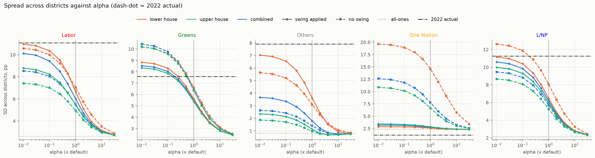
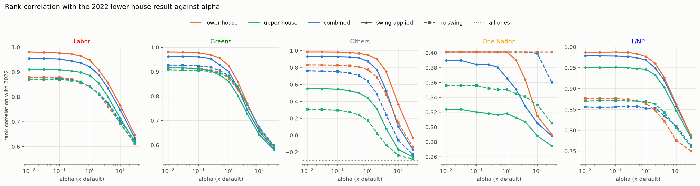
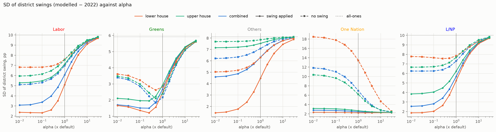
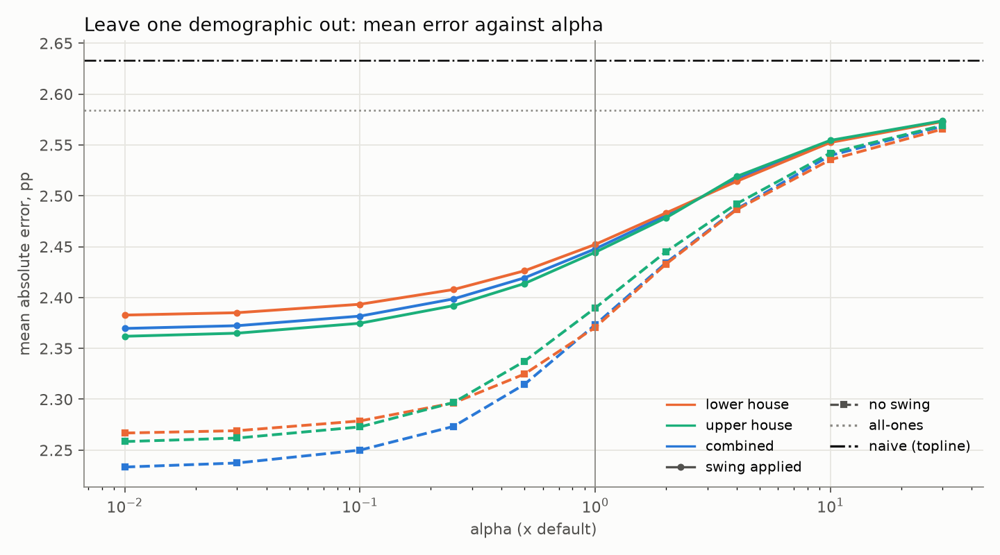
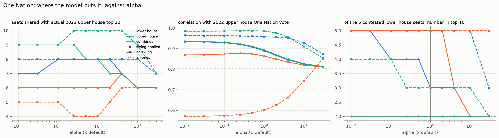

# Swing and alpha

**Recommendation: keep the swing on, and lower alpha from the default to about a quarter of it (`--alpha` ≈ 10,000 pseudo-votes).** The swing is needed for One Nation. Without it One Nation is squeezed into a handful of seats, and it also distorts the other parties' geography. Lowering alpha to about 0.25× brings the district spread of Labor, the Coalition and the Greens much closer to 2022 and improves leave one demographic out (LODO) error slightly. Going lower than about 0.1× buys little and brings back the One Nation candidacy distortion.

Generated by [`swing_alpha_comparison.py`](swing_alpha_comparison.py). Same setup as the [seed comparison](seed_comparison_report.md): Sep 2026 survey, adult-citizen population base, `--seed-weight 1`. Every one of the 61 fits reproduced all of its survey margins (worst miss 9e-9%), so the differences below come from the seed, not from failed fits. At the default setting (combined, swing, 1×) the numbers match the seed comparison report.

## What was varied

- **Seed:** lower house, upper house, and combined (upper house weight 0.5). all-ones is fitted once as a reference.
- **Swing:** applied or not (`--apply-swing`).
- **Alpha:** written as a multiple *m* of the default, which is the mean district formal vote (about 41.5k pseudo-votes). A district keeps 1 / (1 + *m*) of its own 2022 result and takes the rest from the statewide shares.

| *m* | 0.01 | 0.1 | 0.25 | 0.5 | **1 (default)** | 2 | 4 | 10 | 30 |
|---|---|---|---|---|---|---|---|---|---|
| Weight on district's own 2022 result | 99% | 91% | 80% | 67% | **50%** | 33% | 20% | 9% | 3% |

**"No swing" means a proportional swing, not no swing.** With the swing off, the seed is still the 2022 pattern, and IPF rescales each party to the survey topline by multiplying. That is a proportional swing. The `--apply-swing` option adds the same number of points to every district instead (see `apply_swing`). So this is a comparison of additive v proportional swing as much as swing v none.

The two methods differ most for One Nation, which starts at about 1% in 2022 and is now at about 20%.

## 1. Spread across districts

Standard deviation across districts (pp), combined seed. 2022 actual: Labor 11.1, Greens 7.6, Others 7.9, One Nation 1.2, L/NP 11.3.

| Swing | *m* | Labor | Greens | Others | One Nation | L/NP |
|---|---|---|---|---|---|---|
| applied | 0.1 | 9.4 | 8.0 | 3.3 | 3.1 | 9.8 |
| applied | 0.25 | 8.5 | 7.4 | 2.9 | 3.0 | 8.8 |
| applied | **1** | **6.0** | **5.5** | **1.8** | **2.7** | **6.2** |
| applied | 4 | 3.8 | 3.5 | 0.9 | 2.5 | 3.6 |
| none | 0.1 | 8.0 | 9.8 | 2.4 | 11.8 | 8.8 |
| none | 0.25 | 7.4 | 8.9 | 2.1 | 10.7 | 8.0 |
| none | 1 | 5.5 | 6.5 | 1.4 | 7.8 | 5.7 |
| none | 4 | 3.7 | 3.9 | 0.8 | 4.5 | 3.4 |

- **Alpha is the main control on spread.** Spread falls steadily as alpha rises. By 4× every seed is close to all-ones (SD about 2–4pp). The order of the seeds is the same everywhere: lower house is widest, then combined, then upper house.
- **The default is about half of 2022's spread, as the seed comparison said.** Lowering alpha to 0.25× gets Greens to 7.4 (2022: 7.6) and the major parties to about 8.5–8.8 (2022: about 11).
- **Returns diminish below about 0.1×.** At 0.01× Labor is 10.1, against 9.4 at 0.1×. Others never gets close to 2022's 7.9. The most it reaches is 7.0 (lower house seed, with swing, at 0.01×).
- **Swing does different things to different parties.** At the default it raises the spread of Labor (5.5 → 6.0), L/NP (5.7 → 6.2) and Others (1.4 → 1.8), and lowers Greens (6.5 → 5.5). Without swing, Greens overshoots 2022 at low alpha (10.4 at 0.01×).
- **The swing flattens One Nation, and the proportional version doesn't.** With the additive swing, One Nation's SD is about 3pp at every alpha. With the proportional swing it is 7.8pp at the default and 12.6pp at 0.01×.
- **As in the seed comparison, comparing against 2022 partly flatters the seeded runs**, since they are built from 2022.

Rank correlation with 2022, combined seed:

| Swing | *m* | Labor | Greens | Others | L/NP |
|---|---|---|---|---|---|
| applied | 0.25 | 0.94 | 0.95 | 0.92 | 0.98 |
| applied | **1** | **0.92** | **0.90** | **0.87** | **0.97** |
| none | 0.25 | 0.87 | 0.92 | 0.73 | 0.86 |
| none | 1 | 0.84 | 0.88 | 0.64 | 0.85 |

- **Applying the swing improves how well the other parties' district ranking matches 2022**, most for Others (0.64 → 0.87) and L/NP (0.85 → 0.97). This is consistent with the proportional version needing to build a 20% One Nation vote out of seats where it had almost none, and bending the other parties' geography to make room. I haven't isolated that mechanism.
- **Lower alpha raises rank correlation slightly** when the swing is on. By 10× it has fallen to 0.75 for Labor and 0.66 for Greens, and Others is near zero (0.10).

## 2. Swing by district

District swing = modelled share − 2022 lower house share. SD of district swings (pp), combined seed:

| Swing | *m* | Labor | Greens | Others | One Nation | L/NP |
|---|---|---|---|---|---|---|
| applied | 0.1 | 3.4 | 1.5 | 4.9 | 2.7 | 2.8 |
| applied | 0.25 | 4.0 | 1.5 | 5.3 | 2.7 | 3.4 |
| applied | **1** | **6.1** | **2.7** | **6.3** | **2.5** | **5.7** |
| applied | 4 | 8.4 | 4.5 | 7.4 | 2.3 | 8.2 |
| none | 0.25 | 5.7 | 2.2 | 6.5 | 9.9 | 6.4 |
| none | 1 | 7.0 | 2.2 | 7.1 | 7.0 | 7.3 |
| all-ones | – | 10.0 | 5.9 | 8.1 | 2.3 | 10.0 |

- **Higher alpha makes the district swings less uniform.** At 30× the swing SDs are about the all-ones values (Labor 9.7), which the seed comparison called implausible. At 0.1× the swing is close to a uniform shift (Labor SD 3.4).
- **Applying the swing makes district swings smaller and closer to uniform for every party except Greens**, whose swing SD rises a little (2.2 → 2.7 at the default). At the default, L/NP's swing SD drops from 7.3 to 5.7.
- **The mean district swing matches the survey** for every party with or without the swing applied (for example Labor −11.7 v −11.6 against a survey swing of −11.6), so the swing is not moving the statewide totals.
- **The swing SD says how uneven the swing is, not whether it's right.** There is no 2026 district result to check it against, and a swing SD of about 3–4pp is neither more nor less plausible than 6pp. The sub-state check in the next steps is the way to separate them.

## 3. Leave one demographic out

Mean absolute error (pp) across the six omitted demographics, combined seed. Naive baseline 2.63, all-ones 2.58.

| *m* | 0.01 | 0.1 | 0.25 | 0.5 | **1** | 4 | 30 |
|---|---|---|---|---|---|---|---|
| swing applied | 2.37 | 2.38 | 2.40 | 2.42 | **2.45** | 2.52 | 2.57 |
| no swing | 2.23 | 2.25 | 2.27 | 2.32 | 2.37 | 2.49 | 2.57 |

- **Lower alpha helps every seed.** All rise steadily with alpha and reach the all-ones level at 30×. The gain from the default to 0.25× is 0.05pp with the swing, 0.10pp without.
- **The swing costs a little**, about 0.08–0.14pp at alpha at or below the default, and nothing by 10×. I don't have a good explanation for it. The proportional version concentrates One Nation in a few seats, so it may happen to carry more demographic signal.
- **These are small differences.** The whole range is 2.23–2.57 against a naive 2.63, and the seed comparison already showed that this test is a structural check and not a way to choose settings.

## 4. One Nation

Combined seed. Overlap is the number of seats shared with the actual 2022 upper house top 10. "Contested" is how many of the 5 seats One Nation stood in at the 2022 lower house are in the top 10.

| Swing | *m* | One Nation range across districts | Top 10 range (pp) | Overlap | Contested in top 10 | Corr with 2022 UH |
|---|---|---|---|---|---|---|
| applied | 0.01 | 13.2–29.3% | 5.3 | 7 | **5** | 0.93 |
| applied | 0.25 | – | 4.3 | 8 | 4 | 0.92 |
| applied | **1** | **13.8–26.1%** | **2.7** | **8** | **3** | **0.89** |
| applied | 30 | 14.6–23.6% | 0.6 | 6 | 2 | 0.81 |
| none | 0.01 | 3.5–63.1% | 29.7 | 8 | 5 | 0.96 |
| none | 1 | 9.3–49.4% | 21.1 | 8 | 5 | 0.96 |
| none | 30 | 14.3–25.7% | 2.5 | 7 | 3 | 0.87 |

- **The swing is what keeps One Nation plausible.** Without it, One Nation has 63% of the vote in its top seat at 0.01×, and 49% at the default (Morwell). With the lower house seed alone and no swing, One Nation is 99.8% in one seat at 0.01×, which is an absurd result. The cause is that One Nation has a zero 2022 lower house share in 83 of 88 seats, so IPF can only fill the other 5.
- **With the swing, lower alpha brings the candidacy distortion back.** At 0.01× all 5 contested seats are in the top 10 again, against 3 at the default. The overlap with the actual 2022 upper house top 10 drops from 8 to 7.
- **The match to the 2022 upper house vote gets better as alpha falls** (0.89 at the default, 0.93 at 0.01×), but only because the seed gets sharper. The seed itself is 50% lower house, which is where the candidacy distortion comes from.
- **The best match to 2022 upper house support is the upper house seed with no swing** (10 of 10 top-10 seats at 0.25–2×, correlation 0.987). That is partly by construction, since it is built from that vote. It is also a much more uneven result than the swing runs: One Nation between 9% and 39% at the default.
- **Which of the two shapes is closer to the truth is open.** The additive swing assumes One Nation gained the same number of points everywhere. The proportional one assumes it gained in proportion to its 2022 upper house vote. The truth is probably in between, and nothing here can tell them apart.

## Recommendation

- **Keep `--apply-swing`.** It is needed for One Nation to be plausible, it makes the other parties' rankings track 2022 more closely, and its LODO cost is small.
- **Lower alpha to about 0.25× the default.** That is about 10,000 pseudo-votes, or about 80% weight on a district's own 2022 result. Greens spread is then close to 2022, Labor and L/NP close about half of the gap, the swings are less variable (Labor SD 4.0, against 6.1) and LODO error is a little lower.
- **Don't go below about 0.1×.** The spread gain is small, and the One Nation candidacy distortion is back by then.
- **Don't go above about 2×.** By 4× the model has lost most of the district pattern.

## Next steps

1. **Take One Nation from the upper house alone** (the first step in the seed comparison). The lower alpha recommended here makes the candidacy distortion worse, which is the problem that change fixes.
2. **Test a hybrid swing.** For example the proportional swing for One Nation on the upper house seed, and the additive swing for the other parties. This is a larger change to `apply_swing`, and it's the only way to see whether the One Nation shape is a modelling artifact.
3. **Check against the survey's region rows** (Inner Metro, Outer Metro, Regional Vic). They are never fitted, so they are the one test of these settings that doesn't depend on 2022. It is the way to choose between the additive swing and the proportional one, and between alpha values.

## Files

- `swing_alpha_comparison.py`: reproduces everything here.
- `swing_alpha_summary.csv`: spread, rank correlation, swing size and seed spread for each seed × swing × *m* × party.
- `swing_alpha_lodo_errors.csv`: LODO error for each configuration and demographic.
- `swing_alpha_one_nation.csv`: One Nation top 10 and statistics for each configuration.
- `swing_alpha_fit_quality.csv`: worst margin miss for each fit.
- `swing_alpha_district_shares.csv`: modelled shares for each configuration and district.
- Plots: `swing_alpha_spread.png`, `_rank_corr.png`, `_swing_sd.png`, `_swing_mean.png`, `_lodo.png`, `_one_nation.png`, `_boxes_swing.png`, `_boxes_noswing.png`.
